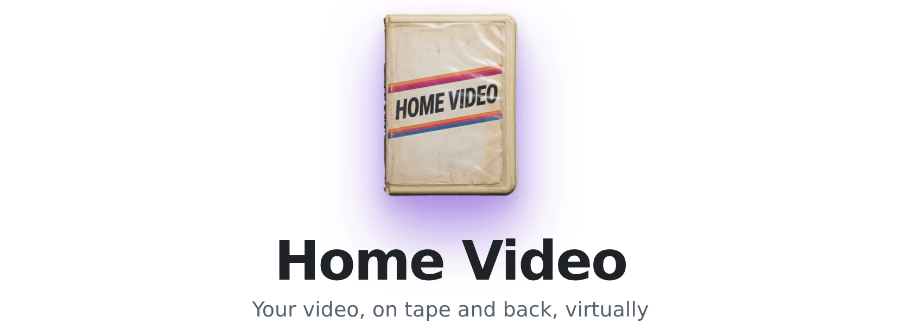
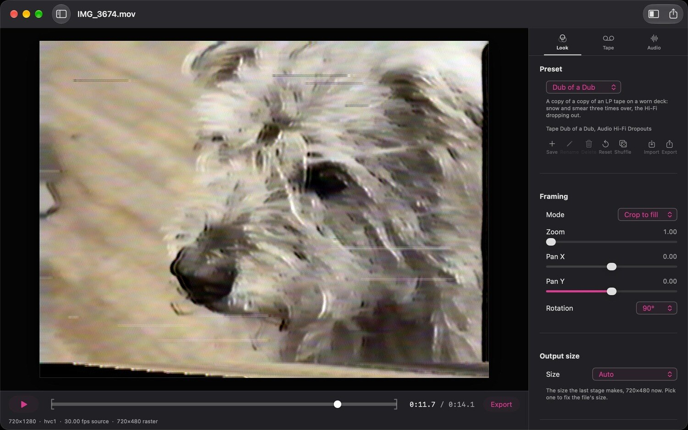

<p align="center">
  <picture>
    <source media="(prefers-color-scheme: dark)" srcset="assets/readme/header-dark.png">
    
  </picture>
</p>

<p align="center">
  <a href="https://homevideo.app">Website</a>
  &nbsp;&middot;&nbsp;
  <a href="https://github.com/chriscantey/home-video/releases/latest/download/HomeVideo.zip">Download</a>
</p>

Home Video puts your video on tape and back, virtually, from the physics. Pick a clip, choose a
Look, and it comes out the way it would after a trip through a camcorder, a VCR and an old TV.

The core of it is the Mac app, which has a bit more power and the workflow features. You can
open a stack of clips, copy settings from one to another, keep each clip's settings next to it,
and export the selected clips in one go. The iPhone app runs on the same engine, trimmed down a
little, especially in its default view, which is a row of Looks and the framing. It works on one
video at a time, picked from Photos or recorded live through a Look with the camera, and saves
it back to your library.

I wanted something that gets the tape right rather than laying a filter over the picture, so
each part of the path is modeled on its own: the film a home movie was shot on, the telecine
that put it on video, the tape's signal and its wear, the tube TV, and a camera filming that
TV. The sound goes through the same trip, from the camcorder's mic to the tape's audio track.

Open source, GPL-3.0, macOS 14 or newer.

<p align="center">
  
</p>

## What it does

- **Looks.** 29 built-in Looks, from a clean S-VHS dub to a rental that's been through too
  many VCRs, plus Super 8, 16mm and 35mm film, film transferred to tape, and a TV filmed off
  the screen. Shuffle rolls a random one and Reset puts it back.
- **Stages.** Film, Telecine, Tape, Display and Audio each get a tab while they're on, with
  presets for that stage and every layer's settings when you want them. The camera filming the
  TV lives on the Display tab.
- **The sound goes on tape too.** The camcorder's mic with its motor whine and hiss, the Hi-Fi
  or linear track, noise reduction and wear, with an Audio wear slider from clean to a badly
  worn tape.
- **Damage on the worn Looks.** Tracking tears, snow, head clogs and creases on the picture, and
  glides, flutter and dropouts on the sound. Each event repeats exactly on every render.
- **Your own presets.** Save, import and export the whole chain as a `.homevideopreset` file.
- **Settings stay with the clip.** Each clip's settings are kept in a small JSON file next to it
  (`clip.MOV.homevideo.json`), so it opens the way you left it.
- **Export.** H.264 in an .mp4 by default, or HEVC, or any ProRes from 422 Proxy to 4444 XQ in a .mov. The size is the last stage's own by default, or the source's size, SD, HD, 4K, a 1080 by 1920 phone size, or your own, with the picture kept inside the frame or filling it. The sound comes along through the same chain.
- **Undo and Redo** for every change, and in and out points to trim a clip before export.

## How it models the tape

The tape and the telecine work at 720 by 480, the NTSC active picture, in component color the way VHS records it. The film stages work on a scan of their own, and the TV and the camera filming it each have a canvas of their own. Each layer models one mechanism, in the order of the real signal path, and with every layer off the picture is the source. The file comes out at the last stage's own size, or whatever you pick under Output size.

Where a published figure exists, a default comes from it. Where there isn't one, it comes from
the tuned values in ntsc-rs, or I set it by arithmetic or by eye. The docs in `docs/` mark
each stage's defaults READ or INFERRED, so you can see which is which.

## Why Mac only

I wrote it for the Mac on purpose. The picture runs on the GPU through Metal, video comes in and goes out through AVFoundation, and the interface is SwiftUI, all Apple's own frameworks, with one outside library, Sparkle, for updates. Sticking to one platform kept it native and lean.

It could be ported. The model itself isn't tied to the Mac, and the docs in `docs/` give every stage and its numbers. A port would mean rewriting the Metal shaders for another graphics API, swapping out the video reading and writing, and a new interface.

## Requirements

- Mac: macOS 14 (Sonoma) or newer, Apple Silicon or Intel.
- iPhone: iOS 26 or newer.

## Install

[Download the latest build](https://github.com/chriscantey/home-video/releases/latest/download/HomeVideo.zip), unzip it, and open it.

If you let it (Settings > Updates), the Mac app checks homevideo.app once a day for a new version. It's a standard HTTPS request with a User-Agent header like `Home Video/1.0 Sparkle/2.10.0`, and nothing else. As with any web request, the server can see your IP address.

## Command line

The Mac app comes with `homevideo-render`, which runs a clip through the same chain with no
window, so you can build it into a script or a pipeline. It sits inside the app at
`Contents/MacOS/homevideo-render`. To call it by name, link it into a folder on your PATH:

```bash
sudo mkdir -p /usr/local/bin
sudo ln -s "/Applications/Home Video.app/Contents/MacOS/homevideo-render" /usr/local/bin/homevideo-render
```

It writes the ProRes 422 master by default, and `--codec h264` matches the app's Export default.

Make a Look in the app, save it with Look > Export Preset, and render with it:

```bash
homevideo-render clip.mov "clip Home Video.mp4" --preset-file "My Look.homevideopreset" --codec h264
```

Or set everything from the command line, starting from a built-in Look:

```bash
homevideo-render clip.mov out.mov --look rental --set damage-snow.enabled=on --size hd
```

For a whole folder, each clip with the settings the app keeps next to it:

```bash
for f in ~/Movies/Tapes/*.mov; do
  homevideo-render "$f" "${f%.*} Home Video.mp4" --clip-sidecar --codec h264
done
```

Run it with no arguments for every option and the order they apply in. `--list-looks` prints
the Looks, and `--list-layers` prints every setting `--set` takes. Everything the app does to a
picture has a flag, apart from Shuffle, which rolls something new every time. From a source
build it's
`.build-arm64/release/homevideo-render`, or `swift run --build-system native homevideo-render`.

## Build from source

Building needs a Mac with Xcode. On Apple Silicon:

```bash
swift build -c release --build-system native --scratch-path .build-arm64
HOMEVIDEO_ARCH=arm64 tools/bundle-app.sh
```

On an Intel Mac, leave out `--scratch-path .build-arm64` and `HOMEVIDEO_ARCH=arm64`.
`tools/bundle-app.sh` wraps the build into an app bundle under `~/build/Home Video`, signed ad
hoc, which is enough for a build that stays on your Mac. A build made this way has no update
feed, so it never checks for updates.

Every `swift` command here takes `--build-system native`. The default build system in current
Xcode tries to compile the Metal shaders itself and stops with an error.

The tests run with `swift test --build-system native`.

For the iPhone app, open `ios/HomeVideoMobile.xcodeproj` in Xcode, pick your own team and a
bundle identifier of your own under Signing, and run it on your phone.

## License

GPL-3.0. See [LICENSE](LICENSE).

## Credits

Home Video uses one open-source library:

- [Sparkle](https://sparkle-project.org) checks for and installs updates. It is MIT (`licenses/sparkle-LICENSE.txt`).

Some defaults where no published spec gives a figure come from the tuned values in
[ntsc-rs](https://github.com/valadaptive/ntsc-rs) by valadaptive and
[crt-royale](https://github.com/libretro/slang-shaders/tree/master/crt/shaders/crt-royale) by TroggleMonkey.

Made with a lot of help from [my AI assistant](https://chriscantey.com/posts/2026-02-24-build-or-buy-may-have-changed/).
